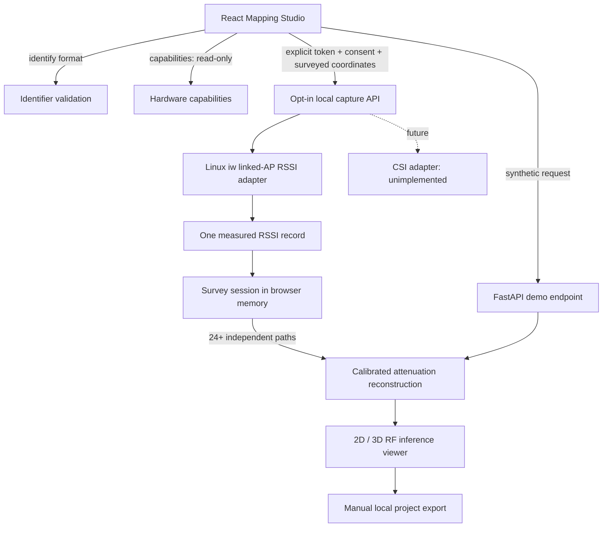

# Hardware integration — MAPS v0.3

## Status

The app has a functioning **synthetic** demo and a working, opt-in **Linux `iw` associated-link RSSI** adapter. No CSI chipset support, router-login integration, Wi-Fi FTM ranging, LiDAR fusion, desktop cross-platform agent distribution, remote connectivity, or automatic wall detection has been implemented. This system does not identify buildings from an IP address.

The browser does not access low-level Wi-Fi radios. The local backend process reads a supported radio on **the same computer**. Running the backend in a cloud service would read only the server's radio (if present), *not* the client's radio. Later mobile/desktop adapters should be standalone companions paired explicitly over a secure loopback/OS transport.

## Component boundaries



## Configure live capture (Linux, local use only)

1. Verify you are authorized to measure the network and building. Install Python 3.11+, `iw`, and supported Wi-Fi drivers. Connect the local machine to the intended Wi-Fi SSID using ordinary OS controls first.
2. Check the device name with your own system tools (for example `ip link`); do not infer it from the router IP.
3. Independently survey transmitter and receiver x/y coordinates in a single coordinate frame. For meshes, record the precise AP **BSSID** to guard against roaming between access points sharing one SSID.
4. Calibrate the **same radio in the same environment** with line-of-sight distance/RSSI measurements using the reference CSV flow. The default coefficients `-40 dBm` and `2.1` are placeholders only.
5. Generate a random secret and start backend **bound to loopback**:

```bash
python -m venv .venv
source .venv/bin/activate
pip install -r backend/requirements.txt
export MAPS_ENABLE_LOCAL_CAPTURE=1
export MAPS_HARDWARE_TOKEN="$(python -c 'import secrets; print(secrets.token_urlsafe(32))')"
echo 'Paste this secret into the Signal Laboratory capture token input; keep it private.'
# Print it locally for manual copying; do not share it or commit it.
printf '%s\n' "$MAPS_HARDWARE_TOKEN"
cd backend
uvicorn app:app --host 127.0.0.1 --port 8000
```

In another terminal start the web interface:

```bash
cd frontend
npm install
npm run dev
```

Open `http://127.0.0.1:5173`, go to **Signal Laboratory**, refresh hardware capability status, enter the **actual associated SSID** (not `192.168.1.6`), interface, local secret, and independently verified x/y positions. Confirm authorization and surveyed coordinate accuracy. The browser sends a single authorized request to `POST /api/hardware/capture`; the backend runs only `iw dev <interface> link`, parses the associated SSID, BSSID and driver RSSI dBm, rejects a mismatch, and returns one measurement. It **never** scans for networks, connects to a router, or runs shell strings.

You can save the session's readings as CSV and continue after moving equipment. A 24-reading minimum does **not** prove observability; sample from multiple AP locations and crossing paths. If all your measurements originate from one stationary AP, the engine may report limited observability, even at higher packet counts.

Never expose either the capture backend or the token to the public internet; this MVP is not hardened for unattended multiuser use.

## REST API

| Path | Method | Purpose | Sends radio requests? |
|---|---|---|---|
| `/api/health` | GET | Service health, no connection assumption | No |
| `/api/identify` | POST | Validate IP/SSID format, require authorization | No |
| `/api/demo/preview` | GET | Return isolated synthetic demo with `SYNTHETIC_DEMO_ONLY` label | No |
| `/api/hardware/capabilities` | GET | Check local backend OS, executable and env gating | No |
| `/api/hardware/capture` | POST | One explicit associated-RSSI sample, requires `X-MAPS-Hardware-Token` header | **Yes, local read-only** |
| `/api/calibrate` | POST | Fit log-distance propagation coefficients | No |
| `/api/reconstruct` | POST | Infer a probabilistic RF attenuation field from supplied samples | No |

Sample capture payload (illustrative coordinates only, **not** evidence of a real building):

```json
{
  "router_identifier": "192.168.1.6",
  "authorized": true,
  "interface": "wlan0",
  "expected_ssid": "YourActualConnectedSSID",
  "expected_bssid": "aa:bb:cc:dd:ee:ff",
  "tx_x": 2,
  "tx_y": 3,
  "rx_x": 6,
  "rx_y": 7,
  "baseline_dbm_at_1m": -40,
  "path_loss_exponent": 2.1
}
```

The IP is used only as a **project identifier**. The backend does not contact that address or verify that the access point corresponds to it. The caller must supply truthful SSID, BSSID and position metadata. The placeholder coefficients above must be replaced by calibrated values for meaningful inference.

## Sensor plugin interface

`backend/hardware.py` defines the `WifiSensor` protocol:

```python
class WifiSensor(Protocol):
    name: str
    def read(self, interface: str, expected_ssid: str, expected_bssid: str | None = None) -> tuple[str, float, str | None]: ...
```

A real CSI integration will require a **separate** protocol with per-subcarrier amplitude/phase tensors, channel frequencies, antennas, timestamps, hardware time synchronization, driver/firmware information, calibration metadata, and an error model. CSI samples must not be coerced into a plain RSSI dBm input. CSI/FTM must be enabled only for compatible equipment with documented calibration and user consent.

## Security controls and outstanding hardening

- Capture disabled by default; requires explicit `MAPS_ENABLE_LOCAL_CAPTURE=1` and a **20+ character** secret set in the backend environment.
- Requires authorization in each capture request; validates interface, private/local identifier, expected SSID and optional BSSID; does not accept arbitrary subprocess commands.
- The token is read from a request **header**, not a URL; it is kept only in browser memory (not saved in project exports). The app's CORS allowlist supports the localhost development origin, but CORS alone is not authentication.
- Limit API listening address to `127.0.0.1` and use only on a trusted local computer. Do not add permissive CORS, public tunnels, or remote access without full per-user authentication, TLS, session binding, audit and permission review.
- An installed router's advertised signal quality, RSSI %, or a private IP address is not a spatial calibration dataset.
